# Real storefront versus Studio: review, 18 October 2026

Status: review complete; fixes proposed, not implemented by this documentation change.

The user's final requirement is that **the real customer store reproduces the styling selected in Studio after publication, at the same available width**. Demo and Studio are reference surfaces only. Implementation must target the real menu, product dialog, basket, checkout, receipt and tracking. Do not redesign or change demo/Studio to make the comparison pass.

## Verdict and scope

The gap is structural. Theme publication reaches the live root, but the customer journey has independent rendering paths with different component recipes and incomplete consumption of theme settings. Missing restaurant imagery and sparse catalog data amplify the difference; they do not explain all of it.

Reviewed the relevant frontend routes, Studio preview composition, theme conversion/validation, public image routing, guest checkout controller, live and demo customer components, shared controls/CSS, existing browser tests, and the theme publication application/domain contracts. This is a focused customer-experience/code review, not a repository-wide backend security audit.

References opened in the existing Chrome profile:

- [Demo storefront](https://white-plate.vercel.app/fr/demo) and [demo Studio](https://white-plate.vercel.app/fr/demo/studio).
- [Connected owner Studio](https://white-plate.vercel.app/fr/organization/theming?tenantId=caf82471-099c-444f-87a1-89246edbef29).
- [Real storefront](https://white-plate.vercel.app/fr/acceptance-check-20261006) and its empty checkout.

The project board's existing **[T3] Theming Studio: live preview, publish and storefront application** card was In review. Its remaining acceptance covers responsive behavior, guest refresh, isolation and preview safety. This review belongs to its real storefront acceptance; it does not create a competing Studio redesign.

## Source and evidence boundaries

At audit start, `origin/main` was `4543323159e82cee03b3681443a829319a99a3bd` (merge of #135). During the review, PR #136 merged as `88de2e3a627cff235cc7aa9d93931f494fc39f92`; the requested documentation branch is updated onto that latest main. Its tracked tree matches the inspected local `b89f0b3` tree (`git diff b89f0b3 origin/main` was empty). PR #136 already addresses portal outline propagation, empty galleries, gallery ratio and unavailable required choices. Those are completed partial fixes, not new implementation tasks. The remaining findings below account for them.

Hosted captures establish visible behavior, not the deployment's exact Git revision. The captured product dialog omitted an empty gallery, consistent with the now-merged partial fix. Earlier source observations against #135 are explicitly separated from the remaining issues on #136.

The initial owner snapshot temporarily disabled controls while refreshing. A later DOM check confirmed controls enabled and no captured console errors. This is not reported as a persistent editor defect. Existing browser-saved demo settings differ between tabs; they are reference observations, not an identical-theme pixel baseline.

## Findings requiring real-store fixes

### F1 — P1: sparse categories turn product images into page-sized blocks

At a measured 1920px browser viewport, the real category's sole card was **1857px wide and 1189px high**, with a **1043px-high** empty photo. Its title, price and add action were below the initial screen. A valid one-product catalog should remain shoppable.

Cause: [the customer grid](../../apps/frontend/components/theme/landing-demo.css#L331) uses `auto-fit` with a `1fr` maximum; empty tracks collapse and the one remaining card fills the row. [The real card](../../apps/frontend/components/storefront/menu-product-card.tsx#L44) always reserves its full image-ratio area, including without a photo. [RestaurantMenu](../../apps/frontend/components/storefront/restaurant-menu.tsx#L135) has no content-width bound. The Studio's 1024px preview with several sample dishes hides this edge case.

Fix in the live store: establish bounded responsive card tracks and a deliberate missing-photo treatment that preserves the selected image ratio without creating a giant empty block. Verify 0/1/2/many products per category, including long descriptions. Keep reference demo/Studio CSS behavior unchanged.

Evidence: captures 02 and 05; live DOM measurements.

### F2 — P1: live overlays lose part of the published appearance

PR #136 corrected a missing `data-button-style` propagation from [LiveCustomerShell](../../apps/frontend/components/storefront/live-customer-shell.tsx#L36) to portalled dialogs. Preserve that fix and its regression coverage.

Separately, [themeVariables](../../apps/frontend/lib/lovable/storeTheme.ts#L192) maps background/foreground/primary/accent but omits `--popover` and `--popover-foreground`; real dialogs use those tokens. A dark/custom storefront can retain the light scoped popup palette. This second issue follows directly from source; the current green hosted theme does not prove every preset's rendered result.

Remaining fix: carry the full live customer appearance into product/basket/receipt overlays, including surfaces and foreground, while retaining the corrected button style/fonts/radii propagation. Use a live-specific integration or an opt-in shared-control extension so demo/Studio output remains unchanged. Test actual computed surfaces/actions, not only a custom-property value at the page root.

Evidence: captures 08/09 illustrate the different modal recipes; current source proves the missing popup palette tokens. Outline propagation is now fixed in source.

### F3 — P1: gallery images drop the restaurant selector on path storefronts

[MenuProductCard](../../apps/frontend/components/storefront/menu-product-card.tsx#L44) gives its cover the restaurant slug. [ProductOrdering](../../apps/frontend/components/storefront/product-ordering.tsx#L25) accepts no slug and [ProductPhotoGallery](../../apps/frontend/components/product/photo-gallery.tsx#L9) passes none to its images. Thus gallery/thumbnail URLs omit `restaurantSlug` even when the cover works.

[The public photo BFF](../../apps/frontend/app/api/public/product-photos/[productId]/[assetId]/[size]/route.ts#L17) resolves the public target from the validated host and explicit slug selector, not the referring page. A central path storefront cannot infer its restaurant from that host alone. This breaks the Vercel path gallery without establishing a cross-tenant leak.

Fix: pass the existing validated restaurant slug through the real product dialog and every gallery image. Retain server-side host/slug validation, no-store delivery, and the absence of browser-selected authorization. The formerly square gallery and empty fallback were already corrected by #136; preserve them.

Evidence: source-confirmed. Hosted acceptance currently has no product photos, so provider-backed gallery success could not be verified.

### F4 — P1: the active checkout bypasses available email and pickup UX

[RestaurantMenu](../../apps/frontend/components/storefront/restaurant-menu.tsx#L137) renders `LiveCheckout`. Its [details component](../../apps/frontend/components/storefront/live-checkout-details.tsx#L49) shows disabled sample pickup choices and a disabled email field. Meanwhile, the real pickup selector is in the opposite summary column. The older [CheckoutPanel](../../apps/frontend/components/storefront/checkout-panel.tsx#L263) already integrates consented email updates and analytics consent, which `LiveCheckout` never renders. The guest controller still exposes those operations.

The active checkout also omits the existing rush-buffer notice and maps paused ordering to a generic no-slots message. Its receipt branch lacks the withdrawal controls present in CheckoutPanel. A separately accessible privacy route does not replace the documented confirmation entry point.

Fix: wire the existing supported controls into the Studio-shaped live checkout; present pickup selection once, where the customer expects it. Preserve unchecked consent defaults, privacy copy, uncertain retry/idempotency and authoritative server totals. Unsupported phone/notes/payment features should not occupy prominent disabled sample forms. Keep honest payment-unavailable information; do not implement a payment system in a visual fix.

Evidence: captures 10/11 and the actual checkout DOM. Empty-cart disabled name/submit controls are expected and are not defects.

### F5 — P2: the live hero and establishment summary use different recipes

[The Studio-rendered reference](../../apps/frontend/components/storefront/demo/storefront/view.tsx#L104) uses a centered vertical hero composition and a compact details strip. [LiveRestaurantIdentity](../../apps/frontend/components/storefront/live-restaurant-identity.tsx#L18) bottom-aligns a banner image, uses different title sizing/padding, and switches to a compact text section without an image. The real [collection summary](../../apps/frontend/components/storefront/collection-information.tsx#L32) expands every address line and all weekly schedule groups. On the 390px live screen, the first product's title/action was not visible in the initial viewport.

Fix: match Studio's visual hierarchy and selected banner alignment/height when an actual image exists. For absent media, keep truthful neutral presentation with comparable typography and spacing. Compact the real address/phone/service summary and expose full hours/details on demand. Do not copy the sample's always-open claim, preparation promise or demo assets into production. Do not impose a 300px empty hero merely to imitate a sample image.

Evidence: captures 01/02, 04/05/07.

### F6 — P2: live product and basket interactions differ from the reference

[The reference card](../../apps/frontend/components/storefront/demo/storefront/section-3.tsx#L42) opens details from the photo or text, uses an accent quick-add control, and puts compact name/description/price together. [The real card](../../apps/frontend/components/storefront/menu-product-card.tsx#L55) splits these across Card sections, enlarges the price, and opens ordering only from a text action. The real dialog has different width, gallery placement, quantity controls and confirmation copy; it lacks the reference's visible configured total.

Fix: reproduce the reference card/dialog/basket composition in live customer components while preserving actual option minimum/maximum rules, availability, allergen declarations and current cart semantics. Use quick-add only when the product needs no required choices. Show a localized configured unit/line estimate before add; checkout/API totals remain authoritative. Preserve keyboard focus and a clear non-color selected state.

Evidence: captures 08/09; card and dialog sources. Required-option and tax/discount differences are contract requirements, not reasons to simulate the demo checkout model.

### F7 — P2: not all live text and spacing obey the controls

[Customer CSS](../../apps/frontend/components/theme/landing-demo.css#L184) scales selected `text-*` utilities. Real product descriptions use `text-body-sm`, category/price text uses `text-headline-*`, and names use `text-base`; those are outside that mapping. Real card padding is fixed at `px-4` and the menu at `px-6`, while the selected spacing only affects some gaps/header padding. Product imagery uses `object-contain` while the reference uses cover cropping. PR #136 corrects the previously fixed-square gallery but does not align all these recipes.

Fix: define live customer semantic typography, density and media recipes that consistently consume the published values, including modal/summary content. Use container width for preview-equivalent behavior. Keep text zoom/reflow usable and provide intentional crop/fallback behavior without stretching source images.

Evidence: source-confirmed; root measurements confirmed the live store already received outline/airy/4px card/10px button/wide-image settings. The gap is incomplete application, not evidence that the theme API lost those values.

### F8 — P2: localization and capability differences need a coherent live policy

The real page's UI is French while its menu selector is EN; some item/group labels remain French and options English. Studio shows FR sample items and euro-prefix formatting. Some of this is saved catalog/fallback data and the deliberate separation of interface versus menu locale. It is not automatically a broken translation router. Real amounts correctly use `Intl.NumberFormat` and the API currency.

Fix: keep the real formatter and menu locale contracts while matching reference hierarchy, alignment and typography. Verify selectable menu-language changes, catalog fallbacks and translated accessible names. Explain unavailable operational features once, near the relevant action; do not retain the sample checkout's broad claim that slots/email are unconnected when those capabilities exist.

Evidence: captures 08/10/11 and their DOM snapshots. No translation or establishment data was edited.

### F9 — P1 acceptance gap: existing tests do not prove Studio-to-store fidelity

`tests/browser/storefront-customer-parity.spec.ts` on main checks route availability, mobile containment and selected live structure; #136 also adds gallery-ratio, outline and unavailable-option assertions. `theme-studio.spec.ts` uses mocked theme transport and primarily tests editing/persistence/containment. Neither establishes identical customer presentation at equivalent width with the same theme and controlled content.

Fix: extend the real-store fixtures/tests to compare rendered typography, surfaces, button style, density, hero/card/gallery geometry, basket and checkout against the unchanged reference. Add visual baselines for sparse and missing-media cases. Prove live interactions separately from appearance. Do not infer hosted success from mock writes or constant-string/class-presence assertions.

## Reference-only observations: not implementation tasks

- Studio uses DEFAULT_MENU/PREVIEW_CART/PREVIEW_ORDER, and its controller deliberately blanks contact/preparation fields. Its displayed domain is synthesized from the restaurant name. The [T3 design](../superpowers/specs/2026-10-16-theme-publication-design.md) explicitly retained sample previews. These explain the data difference; the user's clarified scope excludes replacing that preview or changing Studio navigation/layout.
- Studio's mobile controls push its preview below the initial viewport. This is recorded as reference context, not a requested Studio fix.
- Pure contrast calculations for built-in samples: Burger Pop primary/background is **3.07:1**; Sushi Noir text/accent is **3.21:1**, below T3's 4.5:1 publication rule. Preset/editor/publication-policy changes are outside this real-store fix. Do not weaken publication validation to achieve visual matching.
- Published branding and an unpublished draft are intentionally different states. Matching is required after successful publication and refresh, not while the owner experiments with an unsaved draft.
- Real capability tracking does not expose the demo's complete item/payment summary. Match its available status presentation; do not fabricate an order or extend the public tracking contract solely for screenshot parity.

## Captured walkthrough

All images below were captured and reopened during this run. Mobile images were verified at 390×844. Desktop captures used the existing browser size; it varied between tabs, so they are qualitative comparisons, not pixel diffs. Failed immediate/incorrect-width captures were replaced before acceptance.

1. **Demo storefront and Studio reference — healthy illustrative baseline.** Strong image/name/price/add hierarchy. Saved demo variants and simulated operations are reference limits.

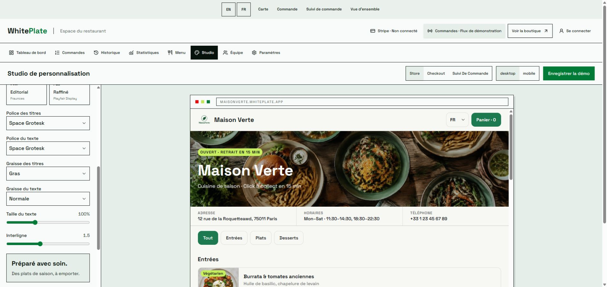
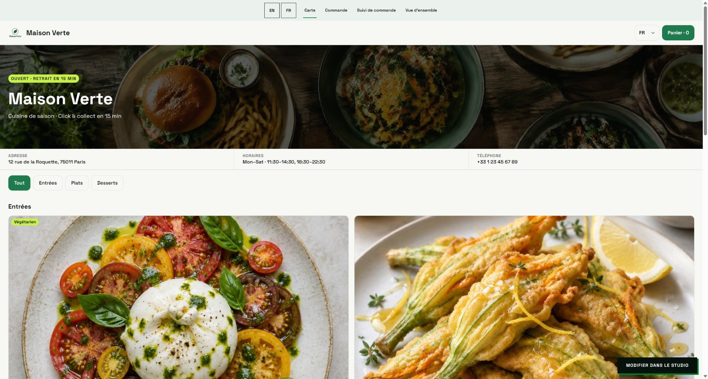

2. **Connected Studio store preview — visual reference with sample-data limits.** The owner's appearance is visible, while sample dishes and empty identity fields differ from production. Temporary initial disabled controls recovered; no persistent lock reported.

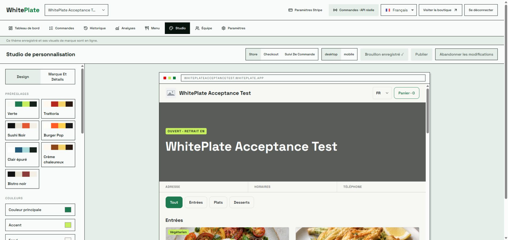

3. **Real menu, desktop/mobile — needs substantial work.** Truthful restaurant/catalog data is present; sparse-card geometry and expanded details bury shopping actions.

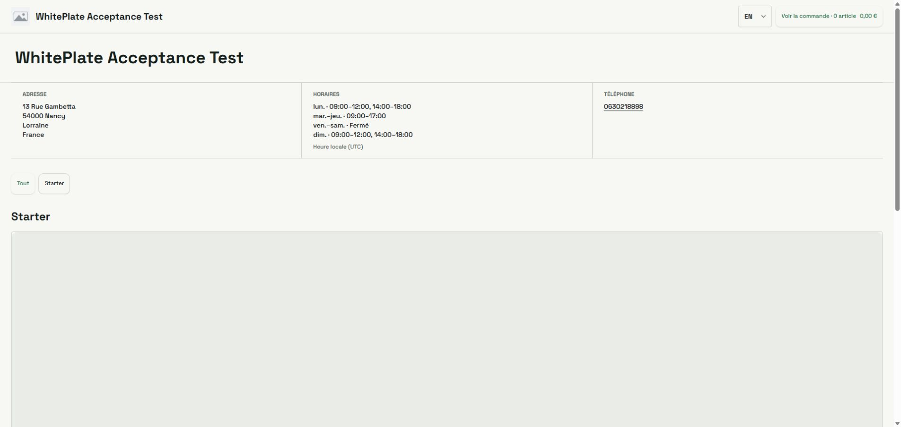
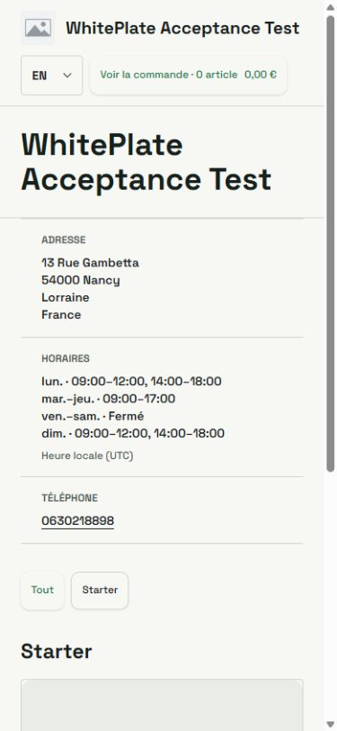
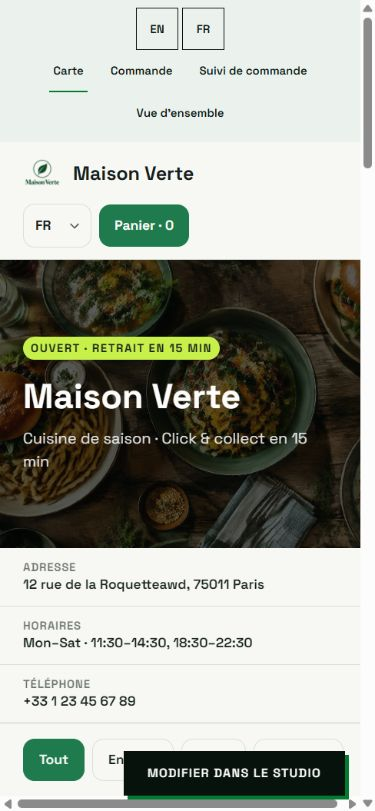
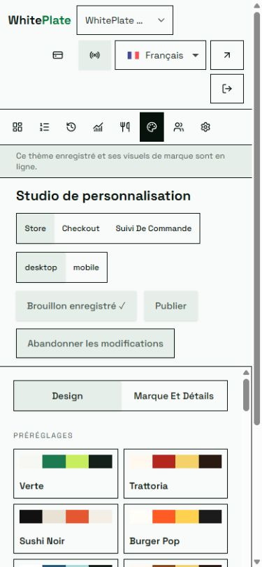

4. **Product dialogs — functional live selection, divergent presentation.** Viewed and cancelled without adding items or submitting orders. Actual photo delivery remains unverified because this product has no photos.

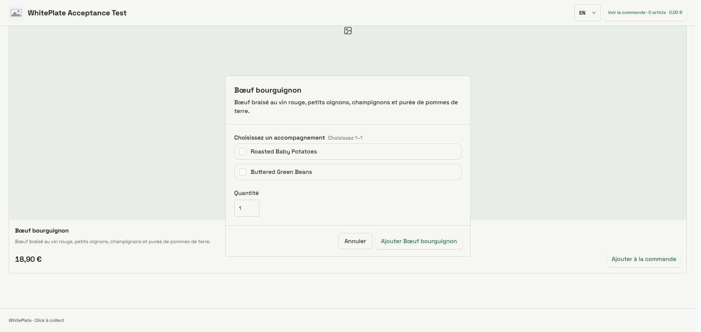
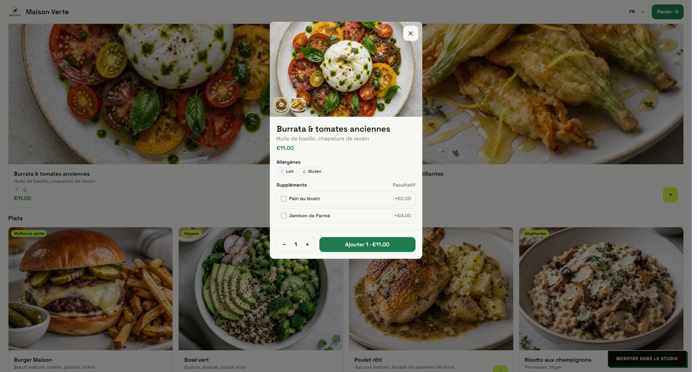

5. **Checkout — live information works, capability/presentation wiring is incomplete.** Opened empty real checkout; no checkout submission. Owner preview contains sample items, therefore totals are not comparable.

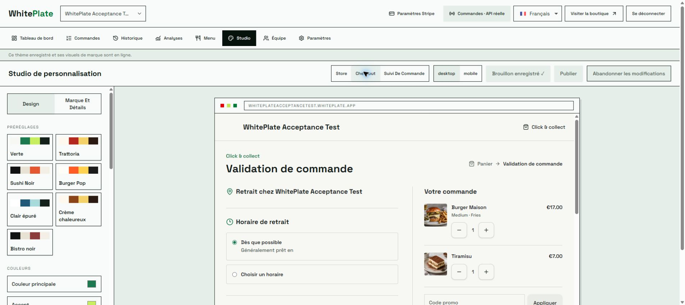
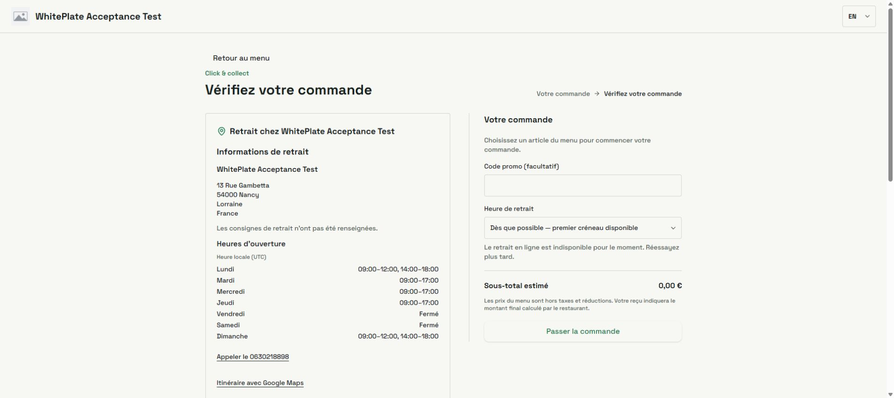

6. **Tracking — sample reference inspected; real receipt/tracking reviewed in source only.** No valid guest capability was supplied, and no order was created to obtain one. Hosted successful tracking and receipt acceptance remain open.

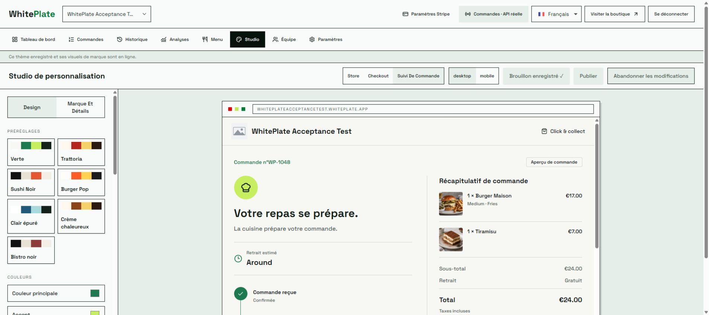

## Verification and limitations

- Fresh Chrome DOM/screenshots: both storefronts, both Studios, product dialogs, connected checkout/tracking previews and real empty checkout; desktop and 390px captures. Temporary viewport emulation was reset. Reference owner tab returned to Store; dialogs cancelled. No theme save/publication, catalog mutation, order, payment or email action was performed.
- Baseline command, from the preserved `apps/frontend` checkout at `b89f0b3`: bundled Node `node_modules/vitest/vitest.mjs run lib/validation/theme-appearance.test.ts lib/product-photos.test.ts lib/storefront-preview-routing.test.ts lib/state/guest-checkout-store.test.ts components/storefront/checkout-panel.test.tsx actions/checkout.test.ts`: **6 files / 39 tests passed**. Its tracked source matches final main `88de2e3`, but these results are not a fresh worktree build or hosted parity.
- A Python calculation of the two preset contrast triplets produced the ratios recorded above. No publication attempt was made.
- The new main-based worktree has no installed `node_modules`; dependencies were not installed for a documentation-only change. No full lint/typecheck/build, automated browser suite or .NET test run is claimed in this audit. Final documentation/whitespace verification is recorded in the handoff.
- Keyboard tab order, focus recovery, screen-reader announcements, reduced motion, every theme, 200% zoom, successful photo delivery, separate guest sessions and two-tenant isolation require the planned implementation acceptance. Screenshots do not establish accessibility compliance.
- GitHub CLI authentication was invalid; the authenticated Chrome project board provided the scope/status and update path. Git remote verification initially failed with a TLS peer-certificate error; using Git's Windows certificate-store backend (`-c http.sslBackend=schannel`) succeeded and refreshed main. No certificate checks were disabled.

See the [real-store-only fix plan](../planning/real-store-studio-parity-fixes-2026-10-18.md).
