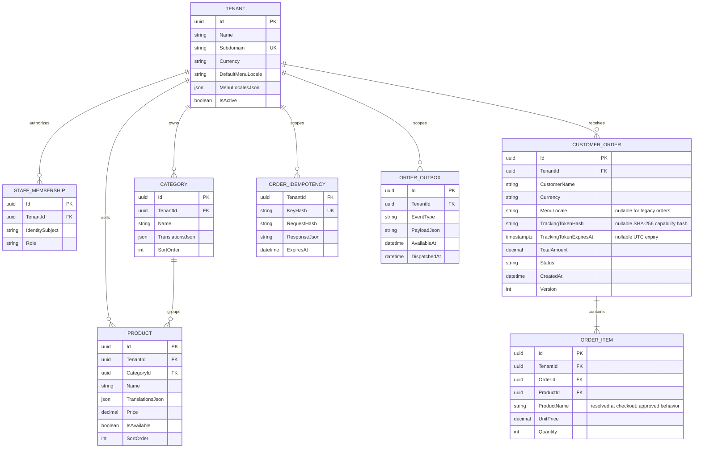

# Database schema and tenant model

## S5 Stripe Connect — 2026-10-17

Generated migration `20261017134031_StripeConnect` adds three tenant/mode-aware tables:

- `StripeConnectConnections` stores one current Stripe account per `(TenantId, Mode)`, with unique `(Mode, StripeAccountId)`, connection/readiness state, Stripe readiness booleans/capability status and requirement counts, connection time, last successful verification and last applied webhook time. It references `Tenants` with restrictive deletion.
- `StripeConnectOAuthStates` stores only the SHA-256 state digest, tenant, initiating owner issuer/subject, mode, locale, creation/expiry and optional consumption timestamp. The digest and expiry/consumption lookup are indexed; a callback atomically consumes it before any code exchange.
- `StripeConnectWebhookEvents` records mode, event ID/type, optional connected account ID and event/received timestamps. Unique `(Mode, EventId)` makes signed Stripe retries idempotent.

Test and live rows are independent. Disconnected rows remain to preserve account uniqueness and audit the prior association; a later owner OAuth can update that tenant/mode row after Stripe revokes it. The migration is generated source only and has not been applied to a shared database. No startup migration is configured.

## S4 transactional order email — 2026-10-17

Generated migration `20261017104323_OrderEmailNotifications` adds required `Tenants.OrderEmailTemplatesJson` (`jsonb`, `{}` default) and `OrderEmailTemplatesVersion` (integer, default 1, optimistic concurrency token). `Orders` adds nullable `CustomerEmail` (`varchar(254)`), `EmailUpdatesConsentedAt` (`timestamptz`), and `EmailTrackingTokenHash` (`varchar(64)`). `OrderEmailDeliveries` stores one row per email-triggering order event, keyed by the authoritative event ID and linked to the order; it records tenant/order/event IDs, recipient, `Pending`/`Sending`/`Accepted`/`Failed` state, attempts/lease/retry timing, provider acceptance ID, safe failure code, and rendered subject/HTML/text snapshots. The snapshots store a tracking-token placeholder, never the raw capability.

Checkout writes the order, idempotency receipt, kitchen outbox event and optional email delivery in one transaction. There are no email rows for cancellation/completion. The order address and consent timestamp clear on terminal status or when the 30-day tracking period expires; queued delivery recipients and content clear on provider acceptance/final failure or when tracking expires. The separate worker uses leases and bounded retries. Migration `20261017104323_OrderEmailNotifications` is applied to Coolify Production; no startup migration is configured. The API code remains undeployed, and provider/hosted acceptance is pending. Existing T3 theme columns belong to `ThemePublication`, not this S4 migration. See [decision 0015](../architecture/decisions/0015-transactional-order-email.md), [Coolify rollout evidence](../deployment/coolify.md#s4-transactional-order-email-schema-rollout--2026-10-17), and [API contract](../api/api-contracts.md#s4-transactional-order-email).

## M3 human translation review and glossary — 2026-10-17

Generated migration `20261016222355_M3CatalogTranslationWorkflow` adds tenant-owned `CatalogTranslationReviews` and `CatalogTranslationGlossaryTerms`. Review rows store the catalog entity/locale, candidate text, source and saved-translation fingerprints, version/status, author identity and optional reviewer identity/time. Unique `(TenantId, EntityType, EntityId, Locale, Version)` and queue indexes support scoped review history. Glossary rows store an enabled source/target locale pair and human-managed terms; a normalized source key is unique per tenant and locale pair.

The migration creates empty tables only. It does not touch, copy or attach review metadata to any existing translation. Only new or changed submissions create candidate rows. The migration was applied to Coolify Production on 17 October 2026; post-checks confirmed both tables are empty and `whiteplate_api` has table-level CRUD grants. Migrations are not applied automatically. API deployment and hosted workflow acceptance remain open. See [rollout evidence](../audits/catalog-translation-workflow.md), [decision 0014](../architecture/decisions/0014-human-translation-review.md) and the [API contract](../api/api-contracts.md#m3-human-translation-review-and-glossary--2026-10-17).

## M4 catalog publication and history — 2026-10-16

Generated migration `20261016155331_CatalogPublicationHistory` adds one `CatalogPublicationHeads` row per tenant and append-only `CatalogRevisions` keyed by `(TenantId, Version)`. The head stores the current published version, full catalog snapshot JSONB and update timestamp. Each revision stores its full snapshot, JSONB field change set, action (`baseline`, `publish`, `rollback`, or `availability`), optional source version, actor issuer/subject, and publication timestamp; `(TenantId, PublishedAt)` is indexed. Both tables reference `Tenants` with cascade delete; the head version is the conditional-write concurrency token.

The existing normalized category/product/option/discount rows and tenant menu-language values remain the working draft. The migration seeds each pre-existing tenant as baseline version 1 using its current values and translations. New tenant creation also writes an empty version-1 baseline. Snapshot publication updates the head and appends a revision in the same serializable transaction. Discard restores the current snapshot into the normalized draft and soft-archives/deactivates draft-only entries. Restore publishes a new revision; it never rewrites prior history. Revisions have no automatic retention deletion until a policy is approved.

Public menu, tenant locale and checkout reads use the published snapshot after the API rollout. Existing order snapshots/idempotency records and M5 product-photo rows are independent and are not rewritten. `RestaurantDescriptionTranslations` text and establishment details remain outside the catalog snapshot. This migration was applied to Coolify Production on 16 October 2026 before API deployment, and backfilled both existing tenants at baseline version 1. The API does not migrate on startup; API deployment and hosted runtime acceptance remain pending. See [rollout evidence](../audits/catalog-publication-history.md). See [decision 0013](../architecture/decisions/0013-catalog-publication-and-history.md) and the [API contract](../api/api-contracts.md#m4-catalog-publication-and-history--2026-10-16).
## T3 published theme snapshot

Implementation status: source migration generated; rollout pending.

Generated migration `20261016132000_ThemePublication` adds nullable `Tenants.PublishedThemeJson` (`jsonb`) and required `ThemePublicationVersion` (`integer`, default 1, optimistic concurrency token), plus `MediaAssets.IsInPublishedTheme` (`boolean`, default false) and a `(TenantId, IsInPublishedTheme)` index. Existing tenants are backfilled with the default allowlisted appearance, their current `ThemeDraftVersion`, null publication time, and IDs of their active saved logo/favicon/banner assets. Those active slot assets are marked as protected, preserving existing storefront output during rollout. New tenants keep a null snapshot and resolve to default appearance with no selected assets at publication version 1.

Publication writes lock and recheck the active tenant and organization, persisted owner/manager membership, the expected draft version, and the publication concurrency version. The saved draft and active ready T1 slots are assembled server-side; the snapshot and complete media-protection marker set commit together. The browser cannot submit theme values or media IDs. Public theme and brand-media reads resolve from the host-selected tenant and exact IDs in the snapshot. A published asset is excluded from cleanup and has no expiry; when a retired published asset is released by a later publication, its seven-day cleanup window starts then. The migration is generated source only, has not been applied to a shared database, and no API startup migration is configured.

## T2 theme drafts — 15 October 2026

Migration `20261015171219_TenantThemeDraft` adds nullable `Tenants.ThemeDraftJson` (`jsonb`) and required `ThemeDraftVersion` (`integer`, default 1). Existing restaurants resolve the same Lovable defaults without backfilling JSON. The version is independent of establishment, legal and ordering versions. Owner/manager writes conditionally update only these columns and recheck active organization/restaurant membership in SQL. Appearance validation excludes identity, assets, domain data and arbitrary CSS/font URLs. No published theme is introduced. The migration was applied to Coolify Production through Chrome on 15 October; both existing tenants retain null JSON/version 1. Other environments and hosted API verification remain separate; no startup migration is added. See [decision 0012](../architecture/decisions/0012-tenant-theme-drafts.md) and [API contract](../api/api-contracts.md#t2-theme-drafts--15-october-2026).

## Menu discount eligibility — 2026-10-14

Generated migration `20261014211126_DiscountMinimumAndExpiration` adds required `PromotionDiscounts.MinimumOrderAmount` (`numeric(12,2)`, default `0`) and nullable `PromotionDiscounts.ExpiresOn` (`date`). Existing discounts therefore remain eligible without a minimum or expiry. Checkout compares the minimum with the saved-price subtotal of product and option quantities before taxes and discount, and accepts a code through the expiration date in the tenant's saved time zone. The migration is source-only; no shared or production database was changed, and the API does not migrate on startup.

## S1 organization and restaurant legal profiles — 2026-10-12

Generated migration `20261012190104_LegalProfileSettings` adds nullable `Organizations.LegalCountryCode`, `LegalName`, `LegalRegistrationNumber`, and `TaxIdentifier`; `Organizations.LegalProfileVersion` is a concurrency token defaulting to 1. `Tenants` receives corresponding nullable custom-profile fields plus `LegalProfileMode` (`inherit` by default) and `LegalProfileVersion` (default 1). Existing rows receive no fabricated country or identifier. In inherited mode tenant profile fields are null and the effective values are read from the owning organization. Tax rates and order records are unchanged. It is applied to Coolify Production and was also applied to Neon `test` on 2026-10-14; hosted acceptance remains open.

## S1 establishment fields — 2026-10-12

Generated `20261012113559_EstablishmentSettings` is applied to Coolify Production and was also applied to Neon `test` on 2026-10-14. Existing `Tenants.Name` remains the trade name. [Rollout evidence](../audits/establishment-settings.md).

| New Tenants columns | PostgreSQL type | Rules/defaults |
| --- | --- | --- |
| `Phone` | `varchar(40)` | Nullable |
| `AddressLine1`, `AddressLine2` | `varchar(200)` | Nullable; supplied address requires line 1, city and country via Domain |
| `PostalCode` | `varchar(20)` | Nullable international text |
| `City`, `Region` | `varchar(100)` | Nullable |
| `CountryCode` | `varchar(2)` | Nullable ISO alpha-2 |
| `Latitude`, `Longitude` | `numeric(9,6)` | Nullable paired coordinates; bounds before rounding |
| `TimeZone` | `varchar(100)` | Required, default `UTC` |
| `PickupInstructionsJson` | `text` | Required locale/text object, default `{}`; disabled languages retained |
| `EstablishmentVersion` | `integer` | Positive conditional-write version, default `1` |

Conditional persistence checks the expected establishment version and menu configuration, updating only establishment columns. No new index/table/order column is introduced; tracking uses existing nullable `Orders.MenuLocale`. Runtime membership and active-organization/tenant checks remain mandatory; schema alone cannot authorize tenant access.

## S2 weekly opening hours — 2026-10-12

Generated migration `20261012171223_OpeningHours` adds nullable `Tenants.OpeningHoursJson` (`jsonb`). Null preserves the distinction between an existing tenant with no configured hours and a saved all-closed week. The JSON stores seven ISO weekdays independently, each with a closed flag and up to eight same-day local-time service windows. Conditional establishment writes use the existing version and persist hours with the scalar settings. The migration is applied to production PostgreSQL; see [rollout evidence](../deployment/coolify.md#production-opening-hours-rollout--2026-10-12).

## S3 pickup scheduling — source schema, rollout pending

Generated migrations `20261012202407_PickupScheduling`, `20261012203204_PickupTimeZone`, and `20261012204056_PickupSlotCapacity` add defaulted `Tenants.PickupSchedulingJson`, nullable `Orders.PickupAt` and `Orders.PickupTimeZone`, and UTC `Orders.PickupAtTicks` for provider-neutral capacity keys. Migration `20261013191310_OrderPickupMode` adds nullable `Orders.PickupMode` (`Asap` or `Scheduled`). New orders snapshot the guest's original choice because an ASAP request resolves to a concrete slot and cannot be distinguished from the same slot chosen explicitly by inspecting `PickupAt` alone. Existing orders remain null. `PickupSlotUsages` is keyed by `(TenantId, SlotStartTicks)` with a bounded `ReservedCount`; `PickupSlotReservations` has one row per `OrderId`, tenant/slot keys and nullable `ReleasedAt`. Checkout creates the order, reservation, counter increment, idempotency response and outbox event in one transaction. Early cancellation marks release and decrements the counter in the order-status transaction. The S3 and K1 pickup-mode migrations were applied to Coolify Production on 2026-10-13 and to Neon `test` on 2026-10-14. PostgreSQL concurrency and hosted/browser acceptance remain open; there is no startup migration. See [S3 verification](../audits/pickup-scheduling.md) and [K1 Live Orders evidence](../audits/live-orders.md).

## M2 product metadata — 2026-10-11

Migration `20261011125310_ProductMenuMetadata` adds nullable `Products.Sku`, JSON-backed `ContainsAllergensJson`, `MayContainAllergensJson`, `DietaryTagsJson`, `PreparationNotesJson`, and optional `PreparationMinutes`. A filtered unique index on `(TenantId, Sku)` normalizes SKU case in the domain and retains uniqueness for archived products. `OrderLines` receives matching declaration/note JSON and preparation minutes so saved disclosures survive catalog edits. Existing products and order lines migrate to empty arrays/objects. The migration is applied to Neon `test`; Coolify Production rollout and hosted acceptance remain separate. See [decision 0009](../architecture/decisions/0009-menu-product-metadata.md) and [M2 evidence](../audits/menu-builder-metadata.md).

## D2 dashboard metric source fields — 2026-10-14

Generated migrations `20261014122001_DashboardMetricsPreparationTimestamps` and `20261014122436_DashboardMetricsTenantStatusIndex` add nullable `Orders.PreparingAt`, `PreparingAtTicks`, `ReadyAt`, and `ReadyAtTicks`, plus `(TenantId, ReadyAtTicks)` and `(TenantId, Status)` indexes. The order lifecycle sets each timestamp when it first enters Preparing or Ready. Existing orders remain null; there is no fabricated backfill. Metrics use immutable `OrderLine` product snapshots and retained archived `Order` rows; no catalog join or new analytics fact table is introduced. These additive migrations are applied to Coolify Production and Neon `test`. The API does not migrate on startup; PostgreSQL query-plan and hosted acceptance are still required. See [D2 API semantics](../api/api-contracts.md#d2-restaurant-dashboard-metrics--implemented-in-source-migration-rollout-pending) and [verification](../audits/dashboard-metrics.md).

## D3 persisted ordering controls — 2026-10-14

Generated migration `20261014150246_OrderingOperations` adds `Tenants.AcceptingOrders` (boolean, default true), `Tenants.RushHoldEnabled` (boolean, default false), and `Tenants.OrderingOperationsVersion` (integer, default 1). The version is conditionally incremented when either setting changes; no-op writes preserve the version. Rush duration remains a domain constant of ten minutes rather than a configurable column. No existing orders, reservations or slot counters are rewritten. The migration and its predecessors are applied to Neon `test`, and D3 is applied to Coolify Production. The Neon rollout happened before Coolify was clarified as the target. There is no startup migration; Coolify API and Vercel Production deployment from open PR #92, PostgreSQL concurrency checks and hosted behavior remain open. See [D3 API semantics](../api/api-contracts.md#d3-dashboard-rush-hold-and-emergency-pause--implemented-in-source-schema-applied), [decision 0011](../architecture/decisions/0011-dashboard-ordering-operations.md) and [D3 verification](../audits/dashboard-rush-pause.md).

## Menu manager category reassignment — 2026-10-09

The 9 October menu-manager refactor permits reassignment of the existing `Products.CategoryId` through product updates. Both categories are checked against the same tenant and archival state before persistence. Existing composite foreign keys remain authoritative; there are no added columns, schema changes or migrations for this refactor. See [menu-manager evidence](../audits/menu-manager.md).

## M5 product photo media extension — 2026-10-09

Generated migration `20261009112850_ProductPhotoGallery` adds nullable `MediaAssets.ProductId` and default-zero `SortOrder`. The composite foreign key `(TenantId, ProductId)` references `Products(TenantId, Id)`, with restricted deletion. Active brand-slot uniqueness applies only to `ProductId IS NULL`; the tenant/product/active/order index supports ordered galleries. Each photo owns three normalized object keys suffixed `/320`, `/640`, `/1200`.

Gallery activation/order/retirement commits in one serializable transaction against expected current ordered IDs. Drafts expire after 24 hours and replaced/removed photos after seven days. Active brand rows are preserved. `ProductPhotoGallery` was applied to Coolify Production on 2026-10-11 after both T1 migrations; see the [Coolify runbook](../deployment/coolify.md). Before downgrade, clear active product galleries because the prior tenant/slot unique index cannot represent several active product images. See [ADR 0008](../architecture/decisions/0008-product-photo-gallery.md) and [M5 evidence](../audits/product-photos.md).

Hosting update — 2026-10-06: the new Coolify `whiteplate` database was initialized from empty-target business/auth SQL. Queries confirmed all 9 EF history entries, 16 public tables and 6 auth tables; both localization migrations are included. Runtime roles, the API deployment, and the Vercel Production cutover are in place. Initial probes from the Coolify VPS confirmed Better Auth user lookup and JWKS over verified TLS; they created no account or business data. The operator later completed a hosted signup and email verification, created one organization and one acceptance restaurant, and loaded them in the signed-in Vercel session. The protected server-side `GET /api/v1/me` call and owner-protected kitchen page succeeded. The operator also reports that signed-out and alternate-account visits to that protected restaurant route redirected to `/fr?error=invalid_code`; this access-denial behavior is accepted without repeating the test. One account, organization and restaurant now exist in Coolify; no order has been created. Public storefront access remains open. Existing Neon data remains unchanged; see the [Coolify runbook](../deployment/coolify.md).

Status: organization, tenant, staff membership/invitation, catalog localization, localized order snapshots, idempotency, outbox, and public tracking mappings are implemented in EF Core/PostgreSQL. `PublicOrderTracking` was reviewed and applied to Coolify Production on 2026-10-08. The new `RestaurantDescriptionTranslations` migration adds the default-empty `Tenants.DescriptionTranslationsJson` column; it is generated and covered by local tests, but has not been applied to shared or production databases. The feature application is not deployed there yet; hosted route acceptance remains open. Coolify has no scheduled database backup or completed restore drill.

## Implemented organization, tenant, catalog and order schema

Current EF model includes `Organizations`, `OrganizationOwnerMemberships`, `RestaurantMemberships`, `StaffInvitations`, `Tenants`, `MenuCategories`, `Products`, `ProductOptionGroups`, `ProductOptions`, `PromotionDiscounts`, `CatalogPublicationHeads`, `CatalogRevisions`, `CatalogTranslationReviews`, `CatalogTranslationGlossaryTerms`, `Orders`, `OrderLines`, `OrderLineOptions`, `OrderIdempotencyRecords`, and `OrderOutboxMessages`. Restaurant-owned catalog/order/idempotency/outbox/publication rows carry `TenantId`. Catalog relationships use composite alternate keys and foreign keys so products, groups and options cannot reference another restaurant's parent. Order product and option labels/prices are immutable snapshots. Orders store nullable `MenuLocale`: new checkouts record the effective published locale and pre-migration orders remain null. Public tracking adds nullable `TrackingTokenHash` and `TrackingTokenExpiresAt` to `Orders`; only a SHA-256 hash is persisted, with a 30-day expiry. See [decision 0006](../architecture/decisions/0006-public-order-tracking.md).

`CatalogLocalization` adds `Tenants.DefaultMenuLocale` and `Tenants.MenuLocalesJson`, plus a `TranslationsJson` text column on categories, products, option groups, and options. These normalized catalog values and translations are the M4 draft. The `CatalogPublicationHistory` migration has been applied to Coolify Production; once the matching API is deployed, public menu/tenant locale/checkout resolution uses the published snapshot instead of these draft values. `RestaurantDescriptionTranslations` adds `Tenants.DescriptionTranslationsJson`, a required JSON map keyed by enabled locale and defaulting to `{}` for existing restaurants. Existing rows backfill to English with no extra translations or description. The tenant locale list is an open-ended JSON array of normalized language tags with a required default; there is no fixed language count. Item translation documents remain on their tenant-owned item rows. Product name/description, category name, option-group name, option name, and restaurant description can be translated. The public menu and checkout resolve missing item text to the published default menu language; no machine translation is performed. Restaurant owners/managers edit languages and restaurant descriptions through their existing APIs; changed catalog translations are submitted as review candidates, and approval updates the draft through the M3 workflow. Startup migration is not automatic.

Tenant currency is restricted by Domain to EUR, GBP, or USD. Prices and totals use PostgreSQL numeric precision and C# decimals. Membership identity is issuer plus subject; invitations and idempotency keys are stored as hashes. Staff invitations also store the normalized intended recipient email; legacy invitations with a null email cannot be accepted. Order version and outbox leases are EF concurrency tokens. The seventh migration is `StaffInvitationRecipientEmail`. Review generated SQL before deployment. No startup migration runs automatically.

The Better Auth PostgreSQL adapter stores users, accounts, sessions, verification tokens, rate-limit records, and JWT signing keys in schema `auth`, separate from the EF-managed business schema. The Better Auth CLI owns that schema through `npm run auth:migrate`; EF migrations must not manage these tables. The auth tables are applied on Neon `test`; signup, verification, organization creation, invitation, and acceptance were verified there using locally intercepted email delivery. Vercel Production has also completed hosted email/password signup and verification, organization listing, an authenticated protected API request through the Coolify auth database, and owner access to a restaurant created through the Coolify API. The operator reports that signed-out and alternate-account access attempts to the protected restaurant route redirected to `/fr?error=invalid_code`; accept this frontend denial behavior. Hosted invitation acceptance remains unverified. Better Auth's CLI reports `rateLimit.lastRequest` as a type mismatch (`bigint/int8` in PostgreSQL versus `number` expected) on the test schema; track that warning during hosted acceptance. Apply and verify both schemas independently in each environment, and do not treat these runtime probes as full-schema acceptance.

`OrderIdempotencyRecords` enforces one key hash per tenant, retains a request hash and serialized create receipt for 24 hours, and references the tenant. `OrderOutboxMessages` records event ID, tenant, event payload, occurrence/availability timestamps, lease, retry count, and optional delivery timestamp. Creation/status changes and event records share one transaction. The outbox is at-least-once; consumers deduplicate by event ID.

## Implemented tenant registry

`WhitePlateDbContext` and `TenantConfiguration` live in Infrastructure. `InitialTenants` creates the original registry; `CatalogLocalization` adds the menu-language columns listed below:

| Column | PostgreSQL type | Constraints |
| --- | --- | --- |
| `Id` | `uuid` | Primary key, generated by Domain |
| `Name` | `varchar(200)` | Required; Domain trims and enforces nonempty |
| `Subdomain` | `varchar(63)` | Required, unique `IX_Tenants_Subdomain`; Domain normalizes lowercase DNS labels |
| `DefaultMenuLocale` | `varchar(128)` | Required; normalized language tag; migration defaults existing tenants to `en` |
| `MenuLocalesJson` | `text` | Required JSON array; at least one enabled tag and the default is included; no product-level count cap |
| `DescriptionTranslationsJson` | `text` | Required JSON object keyed by normalized locale; defaults to `{}`; values trimmed and limited to 500 characters |
| `IsActive` | `boolean` | Required; new tenants are active |

`Tenants` is global for host discovery and references its owning `Organization`. Tenant-owned catalog, order, idempotency, and outbox tables use tenant keys and explicit repository filters; catalog relationships use composite tenant foreign keys. The schema has no theme or global EF tenant filter. Inactive tenants retain their unique subdomain. PostgreSQL unique conflicts for the tenant-subdomain index become typed application conflicts, including concurrent attempts.

Supported tenant provisioning paths use domain normalization and reject reserved `www`, `api`, `admin`, `app` labels. Do not bypass them with raw imports: raw SQL must independently preserve those rules. Migrations never run automatically and do not seed demo tenants; `CatalogPublicationHistory` backfills baseline publication rows for existing tenants. See [setup](../development.md#tenant-database-and-local-provisioning), [decision 0001](../architecture/decisions/0001-tenant-foundation.md), and [decision 0003](../architecture/decisions/0003-catalog-localization-and-tenant-domain-policy.md). Tests cover SQLite relational behavior, generated PostgreSQL SQL, and simulated provider errors. `CatalogLocalization` and `LocalizedOrderSnapshots` are applied on Neon `test` and Coolify Production; `CatalogPublicationHistory` is applied to Coolify Production, while API deployment and M4 runtime acceptance remain open.

## Model scope

The current design uses a shared database and schema, with a `TenantId` on tenant-owned business records. The following early ERD is conceptual and predates the approved first-release model: `SHOPPING_CART` and `CART_ITEM` are excluded, and the implemented schema above is authoritative. A tenant ID provides a scoping key; it does not guarantee isolation by itself.

Names in this ERD are conceptual, not generated SQL. `CUSTOMER_ORDER` avoids ambiguity with SQL `ORDER`. `STAFF_MEMBERSHIP` represents persisted issuer/subject access; Better Auth owns account passwords and sessions in a separate schema.

The first release has no persisted guest cart, payment, inventory reservation, or pickup scheduling. The browser cart is tenant-scoped ephemeral Zustand state. Checkout accepts a submitted order request and persists the order snapshots and idempotency receipt. Public status tracking uses the expiring hashed capability described in decision 0006.

## Required constraints for implementation

- Each row has a primary key. Tenant-owned rows require a non-null tenant foreign key.
- Give each referenced tenant-owned entity a unique key on `(TenantId, Id)`. Use composite foreign keys for product-to-category and item-to-order/product relations, so a valid ID from another restaurant cannot be linked accidentally.
- Persisted carts are excluded from the approved first release. If they are added later, scope both the cart and every item to `TenantId`, constrain the token hash within a tenant, and treat possession of the raw cart token as the capability; never authorize by cart UUID alone.
- Normalize and uniquely constrain tenant subdomains; define allowed characters, reserved names, inactive-tenant behavior, and custom-domain handling before onboarding.
- Constrain quantity to positive integers and monetary amounts to nonnegative values. Use the implemented PostgreSQL numeric precision/scale and matching C# decimal handling, not binary floating-point. Currency is EUR, USD, or GBP with two decimal places; line amounts round `AwayFromZero`.
- Store currency, product/option names, prices, tax, discount, and totals on the order and line snapshots. Historical totals survive future menu edits. Checkout computes one non-stacking discount, allocates it across lines, then calculates line tax.
- Restrict persisted status values to `Pending`, `Preparing`, `Ready`, `Completed`, and `Cancelled`. Application logic enforces forward transitions; EF's version concurrency token supports `If-Match`.
- Store order timestamps as UTC instants (`timestamptz`). `ClosedAt` and `ClosedAtTicks` record when an order first enters `Completed` or `Cancelled`; `ArchivedAt` records its removal from the kitchen board. The daily archive uses UTC midnight because restaurants do not yet have a configured timezone. Archive operations retain status and order snapshots.
- Preserve ordered products through archival or restricted deletion; do not cascade-delete historical orders when a product/category is removed. Define order/customer retention and tenant deletion policy before destructive operations.

An order requires at least one item. A simple row-level check cannot enforce the entire parent/child invariant; validate it in the use case and save the order/items transactionally. The ERD cardinality expresses the business invariant, not an automatic SQL guarantee.

## Index and transaction design

Tenant-leading indexes support category/product ordering, order retrieval, idempotency retention, and outbox claiming. Idempotency key hashes are unique with `TenantId`; the kitchen list uses `(TenantId, CreatedAtTicks, Id)`, and the archive worker uses `(Status, ClosedAtTicks, ArchivedAt)`. Verify indexes against actual query plans rather than assuming every example is necessary.

Checkout resolves all products/options within one tenant, validates availability, calculates snapshots, and saves the order, 24-hour idempotency receipt, and outbox event atomically. A response retry with the same key and normalized request returns the persisted receipt. `IsAvailable` is a menu toggle, not a stock quantity/reservation system; concurrent availability changes do not promise stock guarantees.

Concurrent status updates use the order version as an EF concurrency token and require `If-Match`. The outbox stores events in the same transaction as order writes, uses tenant scoping and expiring leases, and schedules failed deliveries for retry. Delivery is at least once.

## Isolation and migrations

Future EF global filters can help scope reads, but they can be disabled and are not write authorization. Protect insertion/update/delete paths, raw SQL, maintenance operations, jobs, and relationship assignment separately. See [tenant security](../architecture/tenancy-and-security.md) and [Microsoft's query-filter reference](https://learn.microsoft.com/en-us/ef/core/querying/filters).

The migration history uses EF Core 10.0.12/Npgsql 10.0.3 and external connection configuration. The daily order-history migration backfills existing terminal orders' close time from `CreatedAt`; the startup worker archives rows already past the current UTC boundary on startup and catches up missed runs without deleting them. New terminal orders from the current UTC day are archived at the next midnight. Two-tenant fixtures cover catalog/order access. Review migration SQL and test it on a branch; never auto-apply changes to production merely because an app starts. `CatalogLocalization` and `LocalizedOrderSnapshots` are applied on the current Neon `test` branch. Coolify Production has all 11 checked-in migrations, including `DailyOrderHistory` and `PublicOrderTracking`. The latter was applied after confirming no existing order rows and that both tracking columns were absent; verification then confirmed its history row, both columns and zero order rows. Hosted tracking remains pending until the feature code is deployed and exercised.

The accepted design allows each restaurant to enable any number of menu languages (minimum one) with a required default. Catalog translation maps are stored on tenant-owned rows, and missing entries use the default language. Both localization migrations are applied on Neon `test` and Coolify Production. Neon `test` browser acceptance covers localized public menus and checkout order snapshots; hosted public tenant storefront/checkout acceptance remains open pending public tenant DNS/TLS. See [decision 0003](../architecture/decisions/0003-catalog-localization-and-tenant-domain-policy.md), [API contracts](../api/api-contracts.md), and [functional acceptance checks](../functional-test-plan.md).

## M1 category visibility migration — 2026-10-08

`20261008195344_CategoryVisibility` adds required boolean `MenuCategories.IsVisible`, with PostgreSQL default `TRUE` so existing categories retain their public visibility. This flag is separate from `IsArchived`; hiding preserves products, option groups, translations, order and product availability. Protected reads include the flag. Public-menu and checkout repositories enforce active, visible parent categories within the resolved tenant. The generated migration and EF snapshot agree; HTTP integration tests exercise persistence with SQLite. The migration chain through D3 is applied to Neon `test` and Coolify Production; hosted M1 acceptance remains separate. Startup still performs no automatic migration. See [M1 evidence](../audits/menu-builder.md).

## T1 media metadata — 2026-10-08

`20261008205518_BrandMediaAssets` creates `MediaAssets`; `20261008210000_BrandMediaPublicationState` adds `WasPublished` (default false). Both are applied in Coolify Production. The checked-in `apps/api/brand-media-migrations.sql` contains the idempotent initial business/auth migration chain through these T1 migrations; it is for initializing an empty database, not for rerunning against the already migrated production database. Review the complete chain including M1 category visibility before using it on another target.

Rows contain generated `Id`, required tenant foreign key with restricted deletion, `Slot`, generated private `ObjectKey` (unique), normalized `ContentType`, `Width`, `Height`, `Bytes`, `IsReady`, `IsActive`, `WasPublished`, UTC `CreatedAt` and nullable UTC `ExpiresAt`. A filtered unique index on `(TenantId, Slot)` where `IsActive = true` permits at most one active asset per slot. `ExpiresAt` is indexed for cleanup. Object keys contain server-assigned tenant and media IDs; filenames and bucket credentials are not persisted here.

Metadata is committed before S3 writes, then marked ready only after successful upload. Activation and unpublished-upload quota checks use serializable transactions. Protected queries explicitly scope tenant and persisted membership. Public queries select the exact ready tenant-owned slot asset ID from `PublishedThemeJson`, not the editable active slot pointer; before T3 migration rollout the API must remain paired with its schema. Upload failures leave private metadata for cleanup. Saving retires the old pointer for seven days and clears the new asset's expiry; if the retired asset is still in the published snapshot it is retained until a later publication releases it, then gets a fresh seven-day cleanup window. Pending drafts expire after 24 hours. The cleanup worker atomically claims expired, nonactive, unpublished rows by marking them not ready and setting an expired tombstone, then deletes object bytes and metadata. Failed object deletion leaves retryable metadata. Provider-version lifecycle is separate from deletion of the current object. No automatic migration or object purge occurs during ordinary app startup beyond the configured cleanup worker's expired-object policy.
